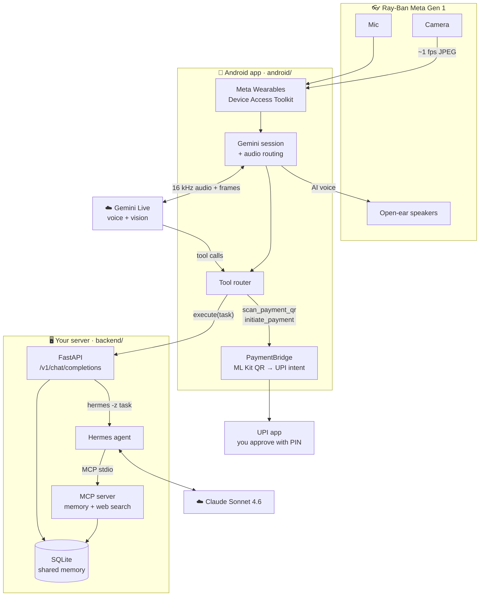
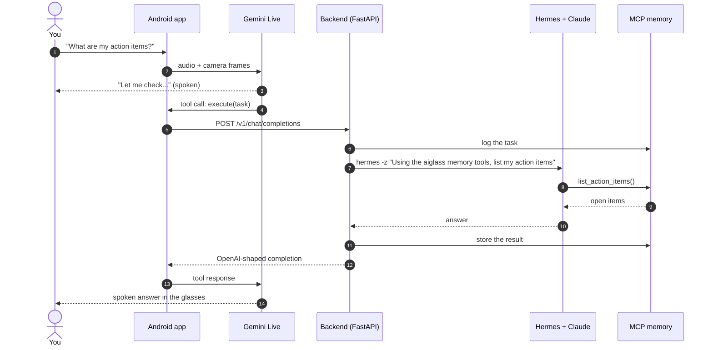
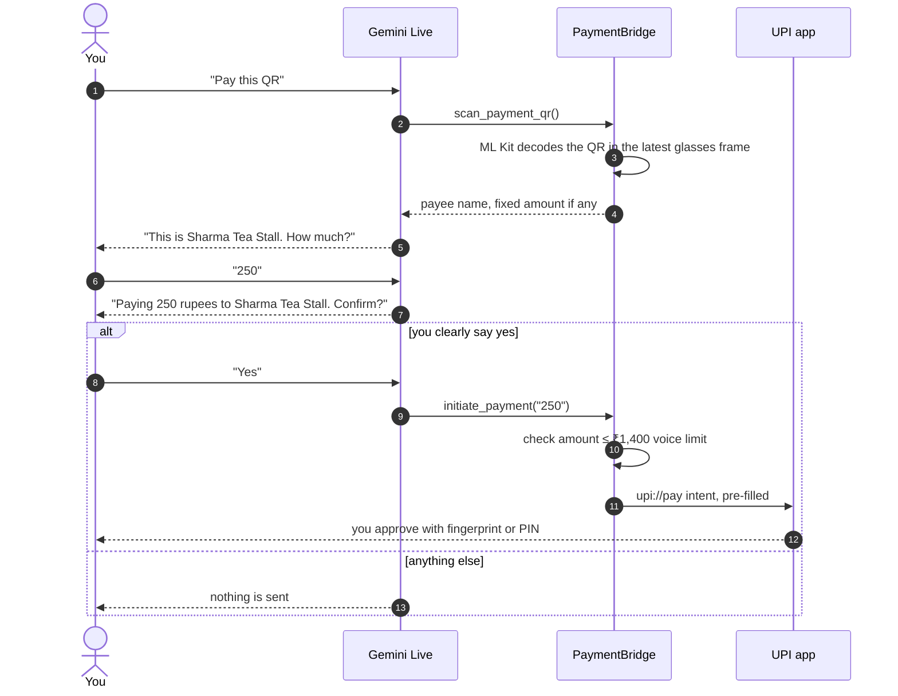

<div align="center">

# aiGlass

**A self-hosted AI agent for Ray-Ban Meta glasses.**
Talk to your glasses. It sees what you see, remembers it, and gets things done.

[](https://github.com/CTAGRAM/aiglass/actions/workflows/backend-tests.yml)


</div>

---

## What it does

| | Say or do | What happens |
|---|---|---|
| 🗣️ **Ask and act** | *"Research budget mechanical keyboards and save the top three to my notes."* | The agent searches the web, saves the shortlist to your memory, and speaks the answer in your glasses. |
| 🧠 **Remember** | *"What were my action items from today?"* | It reads the shared memory of everything the glasses heard, saw and did. |
| 💳 **Pay a QR** | Look at a shop's UPI QR and say *"pay this, 250"* | It reads the payee back, waits for your **spoken confirmation**, and opens your UPI app pre-filled. **You** approve with your PIN. |
| 📳 **Spider-Sense** (ESP32 band) | Something approaches from the side or behind | The band buzzes on that side, stronger the sooner it would reach you. |

Built July–August 2026 · consolidated into this repo October 2026.

## Contents

- [Architecture](#architecture)
- [How a request flows](#how-a-request-flows)
- [Paying a UPI QR safely](#paying-a-upi-qr-safely)
- [Repository layout](#repository-layout)
- [Tech stack](#tech-stack)
- [Quick start](#quick-start)
- [API and MCP tools](#api-and-mcp-tools)
- [Engineering notes](#engineering-notes)
- [Safety and privacy](#safety-and-privacy)
- [Roadmap](#roadmap)
- [Credits and licences](#credits-and-licences)

## Architecture

Two brains share one memory: **Gemini Live** is the fast reflex that talks to you in real time, and the **Hermes agent** (on Claude Sonnet 4.6) is the deep brain that does multi-step work on your own server.



More detail: [docs/ARCHITECTURE.md](docs/ARCHITECTURE.md) · [docs/DUAL_BRAIN.md](docs/DUAL_BRAIN.md) · [docs/SYSTEM_OVERVIEW.md](docs/SYSTEM_OVERVIEW.md)

## How a request flows



The prompt in the app makes Gemini start personal queries with *"Using the aiglass memory tools,"*. Without it, Hermes's built-in (empty) to-do list answers instead of your real memory.

## Paying a UPI QR safely



aiGlass only **prepares** a payment. It never moves money on its own.

## Repository layout

```text
aiglass/
├── android/              Glasses app (Kotlin) — Meta DAT + Gemini Live + tools
│   └── app/src/main/java/.../cameraaccess/
│       ├── gemini/       Live session, audio routing, latest-frame buffer
│       ├── openclaw/     Tool declarations, router, backend bridge, PaymentBridge
│       └── settings/     System prompt and routing rules
├── backend/              FastAPI + MCP server (Python)
│   ├── app/
│   │   ├── main.py       HTTP + WebSocket API, /v1/chat/completions shim
│   │   ├── mcp_server.py MCP tools for the agent
│   │   ├── pipeline.py   audio → transcript → memory → action items → agent
│   │   ├── memory/       SQLite store
│   │   ├── stt/          speech-to-text providers (mock, faster-whisper)
│   │   ├── vision/       frame captioning providers (mock, any OpenAI-compatible LLM)
│   │   └── orchestrator/ agent hand-off (mock, Hermes)
│   └── tests/
├── spidersense/          ESP32 haptic band firmware + build guide
├── deploy/               AWS Lightsail and generic VPS scripts (systemd, Caddy TLS)
└── docs/                 Architecture, sync design, deploy, troubleshooting, roadmap
```

## Tech stack

| Layer | Technology |
|---|---|
| Glasses | Ray-Ban Meta Gen 1, Meta Wearables Device Access Toolkit (camera, Bluetooth audio) |
| Phone app | Kotlin, Jetpack Compose, ML Kit barcode scanning, Android audio routing |
| Real-time AI | Gemini Live (`gemini-2.5-flash-native-audio`), 16 kHz audio in, ~1 fps video |
| Agent | Nous Research Hermes agent on Claude Sonnet 4.6 |
| Tools | Model Context Protocol (FastMCP), Tavily web search |
| Backend | Python, FastAPI, SQLite, asyncio event hub, pluggable STT and vision |
| Infra | AWS Lightsail (Mumbai), Caddy + Let's Encrypt, systemd, bearer-token auth |
| Hardware | ESP32, 4× VL53L1X time-of-flight sensors, ULN2803A, coin vibration motors |

## Quick start

**1. Backend (runs locally with mock providers, no keys needed)**

```bash
cd backend
python3 -m venv .venv && source .venv/bin/activate
pip install -r requirements.txt pytest
python -m pytest tests/ -q
uvicorn app.main:app --reload            # http://127.0.0.1:8000/docs
```

Flip `STT_PROVIDER`, `VISION_PROVIDER` and `ORCH_PROVIDER` to go live. See [backend/README.md](backend/README.md) and [backend/.env.example](backend/.env.example).

**2. Android app**: copy `Secrets.kt.example` to `Secrets.kt`, add a GitHub token for Meta's SDK, enable Developer Mode on the glasses, then build. Step by step: [android/README.md](android/README.md).

**3. Deploy**: one script sets up the backend, the MCP server and HTTPS on a ~$12/month Lightsail box. See [deploy/README.md](deploy/README.md).

**4. Spider-Sense band**: parts list, wiring and a five-step bring-up: [spidersense/README.md](spidersense/README.md).

## API and MCP tools

| Method | Path | Purpose |
|---|---|---|
| `GET` | `/health` | Liveness (no auth) |
| `POST` | `/v1/chat/completions` | OpenAI-compatible shim. Runs the task through Hermes and returns the answer |
| `POST` | `/turn` | Record a Gemini conversation turn into shared memory and broadcast it |
| `POST` | `/ingest` · `/ingest_frame` | One-shot audio/text or camera-frame ingest |
| `GET` | `/memories` · `/memories/search` · `/transcripts` | Read the shared memory |
| `WS` | `/ws/ingest` | Stream audio, frames or text |
| `WS` | `/ws/events` | Live stream of turns, observations and agent results |

| MCP tool | What the agent uses it for |
|---|---|
| `search_memories` | Keyword search over everything captured |
| `recent_transcripts` | What was said recently |
| `list_action_items` | Open tasks extracted from conversations |
| `add_memory` | Write a fact or result back. `result` entries are also broadcast on `/ws/events` |
| `aiglass_public_search` | Web search (companies, products, technologies) |

Every endpoint except `/health` requires `Authorization: Bearer <API_TOKEN>`.

## Engineering notes

The problems that took the longest, written up with symptom → cause → fix in [docs/TROUBLESHOOTING.md](docs/TROUBLESHOOTING.md):

- **Glasses camera stuck on "loading".** Logcat showed `FAILED_TO_BIND_TO_MWA_ACDC_SERVICE`. It was not Wi-Fi: the toolkit's `APPLICATION_ID=0` placeholder only works with Developer Mode on.
- **Gen 1 drops its mic while the camera streams.** A2DP output keeps working but the SCO mic link does not. So the AI speaks through the glasses and the phone mic hears you.
- **Personal UPI QRs were always declined**, identically in GPay, PhonePe and Paytm. All of them share NPCI's library, which refuses third-party-initiated person-to-person intents. Merchant QRs are the right target.
- **The agent ignored real memory.** Its built-in empty to-do tool won the routing; a prompt-level routing rule fixed it.

## Safety and privacy

- **Payments need your voice and your PIN.** A spoken confirmation of payee and amount is mandatory, voice amounts are capped at ₹1,400, and the UPI app always asks you to authorise.
- **The QR's payee name can lie.** Whoever prints a QR sets the name in it. Trust the name your bank shows in the UPI app.
- **It does not identify people.** There is no face recognition and no lookup of strangers.
- **Your data stays on your server.** Memory lives in SQLite on your own VPS. Every endpoint needs a bearer token, and traffic is HTTPS via Caddy.
- **Keys never enter git.** `Secrets.kt`, `local.properties` and `.env` are gitignored.
- **The safety loop is local.** The Spider-Sense haptic path runs entirely on the ESP32; Bluetooth is telemetry only.

## Roadmap

Done, in progress and planned: [docs/ROADMAP.md](docs/ROADMAP.md). Next up: the app subscribing to `/ws/events` so agent results are spoken the moment they land, an LLM-based action-item extractor, Spider-Sense alerts in the app, and porting the brain to Meta's Muse Spark and SAM 3.1 models.

## Credits and licences

- The Android app is based on [Intent-Lab/VisionClaw](https://github.com/Intent-Lab/VisionClaw), which builds on Meta's Wearables Device Access Toolkit sample. Use of the toolkit is subject to the [Meta Wearables Developer Terms](https://wearables.developer.meta.com/terms). See [android/LICENSE](android/LICENSE) and [android/NOTICE](android/NOTICE).
- Agent: [Nous Research Hermes Agent](https://github.com/nousresearch/hermes-agent).
- Spider-Sense is inspired by MateoTechLab's spider-sense glasses.

<div align="center">

Built by **Rudraksh Bharti** · [GitHub](https://github.com/CTAGRAM) · [LinkedIn](https://linkedin.com/in/rudraksh-bharti-7579722ba)

</div>
