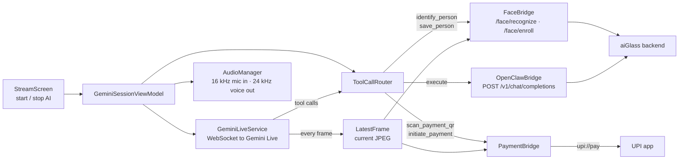
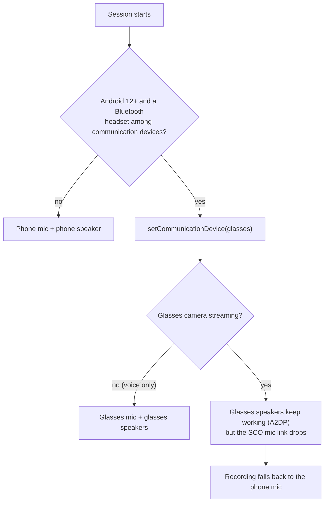

# aiGlass Android app

The phone side of aiGlass. It connects to Ray-Ban Meta glasses through Meta's Wearables Device Access
Toolkit (DAT), runs a live Gemini session over the glasses' camera and audio, and routes Gemini's tool
calls either to the aiGlass backend (agent tasks, saved people) or to on-phone tools such as UPI QR payment.

Based on Intent-Lab's [VisionClaw](https://github.com/Intent-Lab/VisionClaw) Android sample, which builds on
Meta's DAT camera-access sample. See [Credits](#credits).

## How a session runs



## Tools Gemini can call

| Tool | Handled by | What it does |
|---|---|---|
| `execute(task)` | `OpenClawBridge` → backend | Anything durable: web research, notes, lists, memory recall. Runs through the Hermes agent |
| `scan_payment_qr()` | `PaymentBridge` | Decodes the UPI QR in the current glasses frame with ML Kit; returns payee and any fixed amount |
| `initiate_payment(amount)` | `PaymentBridge` | After spoken confirmation, opens the UPI app pre-filled. Refuses amounts above ₹1,400 |
| `identify_person()` | `FaceBridge` → backend | Recognises the person in view **among saved people only**; speaks their name, your notes, what you last talked about and their shared profile |
| `save_person(name, notes?, profile?)` | `FaceBridge` → backend | Saves the person in view (with their agreement), plus an optional profile link they shared |

## What I added to the upstream sample

| File | Change |
|---|---|
| `openclaw/PaymentBridge.kt` | New. QR scan → UPI intent, with amount validation and a voice-payment cap |
| `openclaw/FaceBridge.kt` | New. Calls the backend's people endpoints and turns a recall into one spoken sentence |
| `gemini/LatestFrame.kt` | New. Keeps the most recent camera JPEG for on-demand tools |
| `openclaw/ToolCallModels.kt` | Declares the people and payment tools next to `execute` |
| `openclaw/ToolCallRouter.kt` | Routes people tools to `FaceBridge`, payment tools on-device, everything else to the backend |
| `gemini/AudioManager.kt` | Routes voice to the glasses' Bluetooth headset when possible, falls back to the phone mic |
| `gemini/GeminiLiveService.kt` | Saves each frame into `LatestFrame` |
| `settings/SettingsManager.kt` | System prompt: memory-routing rule, saved-people rules (never guess a stranger) and a strict confirm-before-pay protocol |
| `app/build.gradle.kts` | Adds ML Kit barcode scanning |

## Audio on Ray-Ban Meta Gen 1



On Gen 1 the camera and the two-way SCO mic link can't run together, so with the camera on you hear the
AI in the glasses and the phone captures your voice. A separate Bluetooth earbud also works as the mic.

## Set up and build

1. **Enable Developer Mode** for the glasses in the Meta AI app. The Developer Mode toggle appears only
   after your Meta account is registered as a Wearables developer. Without it the camera stream never starts
   (see [Troubleshooting](../docs/TROUBLESHOOTING.md)).
2. **Add your keys.** Copy
   `app/src/main/java/com/meta/wearable/dat/externalsampleapps/cameraaccess/Secrets.kt.example`
   to `Secrets.kt` and set:

   | Field | Value |
   |---|---|
   | `geminiAPIKey` | Your Gemini API key |
   | `openClawHost` | Your backend, e.g. `https://<your-server>` |
   | `openClawPort` | `443` behind Caddy, or `8000` for a local backend |
   | `openClawGatewayToken` | The backend's `API_TOKEN` |

3. **Give Gradle access to Meta's SDK.** The DAT SDK is served from GitHub Packages. Put a GitHub token
   with the `read:packages` scope in `local.properties` as `github_token=...`, or export `GITHUB_TOKEN`.
4. **Build and install.**
   ```bash
   ./gradlew :app:installDebug
   ```
   Or open this folder in Android Studio and run the `app` configuration.

`Secrets.kt` and `local.properties` are gitignored. Keys stay on your machine.

## Credits

- [Intent-Lab/VisionClaw](https://github.com/Intent-Lab/VisionClaw): the Gemini Live + tool-calling glasses sample this app starts from.
- Meta Wearables Device Access Toolkit sample. Use is subject to the
  [Meta Wearables Developer Terms](https://wearables.developer.meta.com/terms) and
  [Acceptable Use Policy](https://wearables.developer.meta.com/acceptable-use-policy). See [LICENSE](LICENSE) and [NOTICE](NOTICE).
