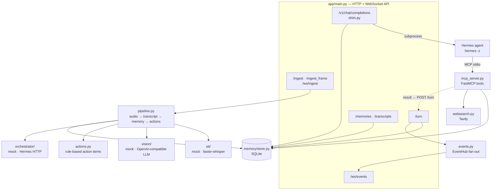

# aiGlass backend

FastAPI service that gives the glasses a durable brain: a shared memory, an OpenAI-compatible endpoint
that hands tasks to the Hermes agent, and an MCP server the agent uses to read and write that memory.

## Module map



| File | Responsibility |
|---|---|
| `app/main.py` | HTTP and WebSocket routes, bearer-token auth, the `/v1/chat/completions` shim that runs `hermes -z <task>` |
| `app/shim.py` | Pulls the task out of OpenAI-style messages and shapes the reply. Stdlib only, unit-tested |
| `app/pipeline.py` | The core loop: transcribe → store transcript → extract action items → dispatch. Also captions frames |
| `app/actions.py` | Rule-based action-item extraction (`remind`, `email`, `buy`, `schedule` …), swappable for an LLM call |
| `app/memory/store.py` | SQLite store for transcripts and typed memories (`turn`, `task`, `result`, `observation`, `action_item`) |
| `app/events.py` | In-process asyncio fan-out behind `/ws/events`. Swap for Redis pub/sub when running several processes |
| `app/mcp_server.py` | MCP tools for the agent. A `result` written here is pinged to `/turn` so it is broadcast live |
| `app/websearch.py` | Tavily web search used by the `aiglass_public_search` tool |
| `app/stt/`, `app/vision/`, `app/orchestrator/` | Provider interfaces (`base.py`) with a dependency-free `mock` and a real implementation |
| `app/config.py` | Environment-based settings and provider factories |

## Providers

Everything defaults to mocks, so the server boots and the tests run with no keys and no heavy wheels.

| Interface | Mock (default) | Real | Switch |
|---|---|---|---|
| Speech-to-text | `stt/mock.py` | `stt/whisper.py` (faster-whisper) | `STT_PROVIDER=whisper` |
| Frame captioning | `vision/mock.py` | `vision/llm.py` (any OpenAI-compatible vision model) | `VISION_PROVIDER=llm` |
| Action hand-off | `orchestrator/mock.py` | `orchestrator/hermes.py` (HTTP push) | `ORCH_PROVIDER=hermes` |

## Endpoints

| Method | Path | Auth | Purpose |
|---|---|---|---|
| `GET` | `/health` | — | Liveness |
| `POST` | `/v1/chat/completions` | ✅ | OpenAI-compatible: runs the latest user message through Hermes, logs task + result |
| `POST` | `/turn` | ✅ | Record a conversation turn (`role`, `text`, `source`) and broadcast it |
| `POST` | `/ingest` | ✅ | One-shot audio or text chunk through the pipeline |
| `POST` | `/ingest_frame` | ✅ | One JPEG frame (raw body) → caption → `observation` memory |
| `GET` | `/memories?kind=` | ✅ | List memories, optionally by kind |
| `GET` | `/memories/search?q=` | ✅ | Keyword search |
| `GET` | `/transcripts` | ✅ | Recent transcripts |
| `WS` | `/ws/ingest` | ✅ | Stream raw audio, or JSON `{"type": "frame"\|"audio"\|"text", "data": ...}` |
| `WS` | `/ws/events` | ✅ | Live events: turns, transcripts, observations, agent results |

Auth is `Authorization: Bearer <API_TOKEN>` (or `?token=` on WebSockets). Leaving `API_TOKEN` empty
disables auth, which is fine on localhost only.

## MCP tools

| Tool | Returns |
|---|---|
| `search_memories(query, limit=10)` | Matching memories |
| `recent_transcripts(limit=20)` | Latest transcripts |
| `list_action_items(limit=50)` | Open action items |
| `add_memory(kind, text)` | The stored memory. `result` / `reply` / `answer` kinds are broadcast live |
| `aiglass_public_search(query, max_results=5)` | Web results from Tavily |

Run it with `python -m app.mcp_server` (stdio). Hermes launches it itself once it is in Hermes's MCP config,
see [docs/HERMES_DEPLOY.md](../docs/HERMES_DEPLOY.md).

## Configuration

Copy [`.env.example`](.env.example) and set what you need.

| Variable | Default | Meaning |
|---|---|---|
| `API_TOKEN` | *(empty)* | Bearer token required on every endpoint except `/health` |
| `AIGLASS_DB` | `aiglass.db` | SQLite path |
| `STT_PROVIDER` / `WHISPER_MODEL` | `mock` / `base` | Speech-to-text |
| `VISION_PROVIDER` | `mock` | `llm` to caption frames |
| `VISION_BASE_URL` / `VISION_API_KEY` / `VISION_MODEL` | OpenAI / — / `gpt-4o-mini` | Any OpenAI-compatible vision endpoint |
| `ORCH_PROVIDER` | `mock` | `hermes` to push action items to Hermes |
| `HERMES_URL` / `HERMES_API_KEY` | `http://127.0.0.1:8080` / — | Hermes task intake for the push mode |
| `HERMES_BIN` | `hermes` | Absolute path to the Hermes CLI used by the shim (systemd's `PATH` is minimal) |
| `HERMES_TIMEOUT` | `120` | Seconds before a shim task times out |
| `TAVILY_API_KEY` | — | Web search for the MCP tool |
| `AIGLASS_API_URL` | `http://127.0.0.1:8000` | Where the MCP process pings `/turn` to broadcast results |

## Develop and test

```bash
python3 -m venv .venv && source .venv/bin/activate
pip install -r requirements.txt pytest
python -m pytest tests/ -q              # pipeline, shim, events, vision, Hermes hand-off
uvicorn app.main:app --reload           # interactive docs at http://127.0.0.1:8000/docs
```

The MCP SDK is pinned below 2.0: version 2 renamed `FastMCP`, which this server uses.
