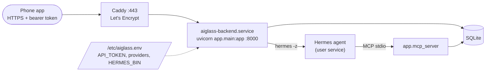

# Deploy

Two ways to run the backend on a server. Both install it as a systemd service; the AWS path also sets up
the MCP service and HTTPS, and is what the live system runs on.

| Path | Best for | Script | Guide |
|---|---|---|---|
| **AWS Lightsail** (recommended) | A ~$12/month box in Mumbai with HTTPS, bearer-token auth and the MCP server | [`aws/bootstrap.sh`](aws/bootstrap.sh) + [`aws/tls.sh`](aws/tls.sh) | [aws/README.md](aws/README.md) |
| **Any Ubuntu VPS** | Vultr, DigitalOcean, Hetzner… run as root from `/opt/aiglass` | [`setup.sh`](setup.sh) | below |

## What ends up on the server



## Any Ubuntu VPS (`setup.sh`)

```bash
# from your machine
ssh root@<server> 'mkdir -p /opt/aiglass'
scp -r backend deploy root@<server>:/opt/aiglass/

# on the server
bash /opt/aiglass/deploy/setup.sh
curl http://127.0.0.1:8000/health          # {"ok": true, ...}
grep API_TOKEN /opt/aiglass/backend/.env   # use as "Authorization: Bearer <token>"
```

Then edit `/opt/aiglass/backend/.env` to go live (see [backend/.env.example](../backend/.env.example)) and
`systemctl restart aiglass-backend`. To wire up the agent, follow [docs/HERMES_DEPLOY.md](../docs/HERMES_DEPLOY.md).
For HTTPS, `aws/tls.sh` works on any Ubuntu box with ports 80 and 443 open.

## Before real use

- [ ] `API_TOKEN` is set (both scripts generate one).
- [ ] HTTPS is on, and public port 8000 is closed once it is.
- [ ] Only SSH, 80 and 443 are open in the firewall.
- [ ] Keys live in `/etc/aiglass.env` or `backend/.env`, never in git.
- [ ] The database volume is backed up or encrypted at rest.
