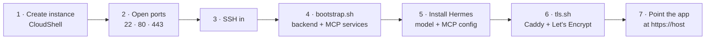

# Deploy on AWS Lightsail

Runs the backend, the MCP server and the Hermes agent on one small Lightsail instance (~$12/month,
`small_3_1`, 2 GB RAM) in Mumbai, with HTTPS from Caddy. Everything is pasted into **AWS CloudShell**, so no
AWS keys ever leave your browser.



## 1. Create the instance (CloudShell)

```bash
REGION=ap-south-1

# Bundle IDs differ by region. List them cheapest first and pick the ~2 GB one:
aws lightsail get-bundles --region $REGION \
  --query 'sort_by(bundles,&price)[].[bundleId,ramSizeInGb,cpuCount,price]' --output table

BUNDLE=small_3_1        # 2 GB in ap-south-1; IDs end in _3_1, avoid the IPv6-only ones

aws lightsail create-instances --region $REGION \
  --instance-names aiglass --availability-zone ${REGION}a \
  --blueprint-id ubuntu_22_04 --bundle-id $BUNDLE
```

## 2. Open the ports

```bash
for p in 22 80 443; do
  aws lightsail open-instance-public-ports --region $REGION --instance-name aiglass \
    --port-info fromPort=$p,toPort=$p,protocol=TCP
done
```

Port 8000 can stay closed: Caddy proxies to it locally. Attach a static IP in the Lightsail console so the
HTTPS hostname never changes.

## 3. SSH in

```bash
aws lightsail get-instance --region $REGION --instance-name aiglass \
  --query 'instance.publicIpAddress' --output text
aws lightsail download-default-key-pair --region $REGION \
  --query 'privateKeyBase64' --output text > key.pem && chmod 600 key.pem   # already PEM, no base64 -d
ssh -i key.pem ubuntu@<public-ip>
```

## 4. Bootstrap the backend (on the instance)

```bash
git clone https://github.com/CTAGRAM/aiglass.git
export REPO_URL=https://github.com/CTAGRAM/aiglass.git
export LLM_API_KEY=...          # key for the OpenAI-compatible endpoint used to caption frames
# optional: export LLM_BASE_URL=... LLM_MODEL=...
bash aiglass/deploy/aws/bootstrap.sh
```

The script installs Python deps, writes `/etc/aiglass.env` (with a fresh `API_TOKEN`, printed once), and
starts `aiglass-backend` and `aiglass-mcp` as systemd services.

## 5. Install the Hermes agent

```bash
curl -fsSL https://hermes-agent.nousresearch.com/install.sh | sh
hermes init
```

- Set its model to **Claude Sonnet 4.6** with your Anthropic API key. Use a direct provider: proxies that
  strip tool definitions break agent tool-calling.
- Add the aiglass MCP server to Hermes's MCP config (`~/.hermes/config.yaml`) as a stdio server: command
  `~/aiglass/backend/.venv/bin/python`, args `-m app.mcp_server`, working directory `~/aiglass/backend`.
- Check `HERMES_BIN` in `/etc/aiglass.env` matches `which hermes`, then `sudo systemctl restart aiglass-backend`.

Details: [docs/HERMES_DEPLOY.md](../../docs/HERMES_DEPLOY.md).

## 6. Turn on HTTPS

```bash
bash ~/aiglass/deploy/aws/tls.sh
```

Caddy gets a Let's Encrypt certificate for `<ip-with-dashes>.nip.io`, so no domain purchase is needed.

## 7. Verify and connect

```bash
curl -s https://<ip-with-dashes>.nip.io/health      # {"ok": true, ...}
```

In the app's `Secrets.kt` set `openClawHost=https://<ip-with-dashes>.nip.io`, `openClawPort=443` and
`openClawGatewayToken=<API_TOKEN>`.

## Costs

- `small_3_1` is about $12/month. AWS credits cover it for months.
- Don't run a GPU instance for a local model; the model APIs are far cheaper at this scale.
- Stop paying any time: `aws lightsail delete-instance --region $REGION --instance-name aiglass`.

## Operate

```bash
sudo systemctl status aiglass-backend aiglass-mcp
journalctl -u aiglass-backend -f
```
