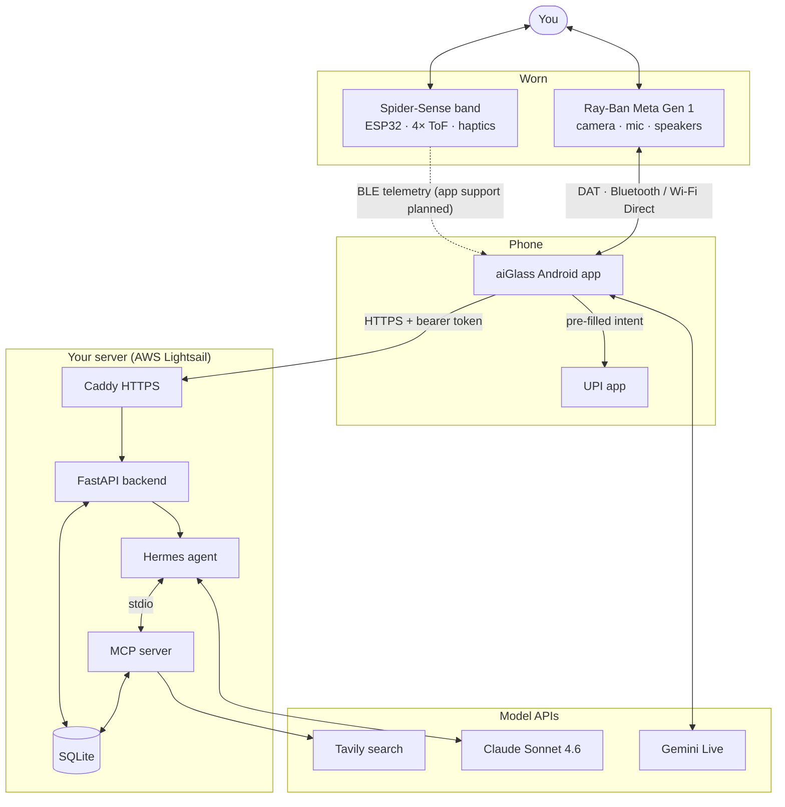
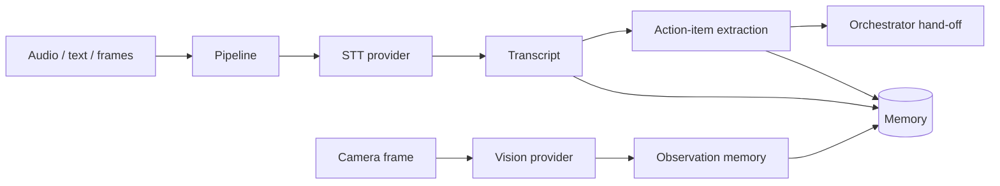

# Architecture

aiGlass is split so that each part does one job and can be swapped without touching the others:

| Layer | Job | Lives in |
|---|---|---|
| **Glasses** | Sensors and speakers only. They never think | Ray-Ban Meta Gen 1 |
| **Phone app** | Pairs with the glasses, runs the real-time Gemini session, handles on-device tools | `android/` |
| **Reflex brain** | Live voice and vision conversation, answers in about a second | Gemini Live |
| **Deep brain** | Multi-step work with tools, on your own server | Hermes agent on Claude Sonnet 4.6 |
| **Memory and tools** | One shared history plus the tools the agent uses | `backend/` |
| **Spider-Sense** | Local haptic safety for blind spots | `spidersense/` |

## System context

## Why this shape

- **Capture is not cognition.** The glasses only stream. All reasoning happens on the phone's live session
  and on your server, so the brain can be upgraded without touching hardware.
- **Two brains, one memory.** Gemini Live is fast but forgetful; the Hermes agent is slower but can do
  real work. Both read and write the same SQLite memory, so nothing either one learns is lost.
  See [DUAL_BRAIN.md](DUAL_BRAIN.md).
- **MCP is the integration seam.** The agent gets memory and search through the Model Context Protocol, so
  Hermes can be swapped for any MCP-capable agent without new glue code.
- **An OpenAI-shaped endpoint is the other seam.** The app already speaks `/v1/chat/completions`, so the
  backend answers in that shape and the app needed no networking changes.
- **Providers are pluggable.** Speech-to-text, frame captioning and the agent hand-off each have a
  `base.py` interface, a dependency-free mock (the default, so tests run anywhere) and a real implementation.
- **Money and safety stay local.** Payments are prepared on the phone and authorised by you in the UPI app.
  The Spider-Sense haptic loop runs entirely on the ESP32.

## Backend internals

The full module map, endpoints and settings are in [backend/README.md](../backend/README.md).

## Request lifecycle

1. You speak. The app streams 16 kHz audio and about one JPEG per second to Gemini Live.
2. For a conversational question, Gemini answers directly and you hear it in the glasses.
3. For real work, Gemini calls `execute(task)`. The app posts the task to `/v1/chat/completions`.
4. The backend logs the task, runs `hermes -z "<task>"`, and Hermes works with Claude and the MCP tools.
5. The answer is stored as a `result` memory and returned. Gemini speaks it.
6. For payments, Gemini calls the on-phone tools instead. Nothing reaches the server.

## Security and privacy

- **Self-hosted memory.** Transcripts and memories stay on your server.
- **Authenticated and encrypted.** Every endpoint except `/health` needs the bearer token. Caddy
  terminates TLS with a Let's Encrypt certificate.
- **No identification of people.** aiGlass has no face recognition and no lookup of strangers.
- **Human-approved money.** A spoken confirmation is mandatory, voice amounts are capped at ₹1,400, and
  the UPI app requires your PIN.
- **Secrets out of git.** `Secrets.kt`, `local.properties` and `.env` files are gitignored.
