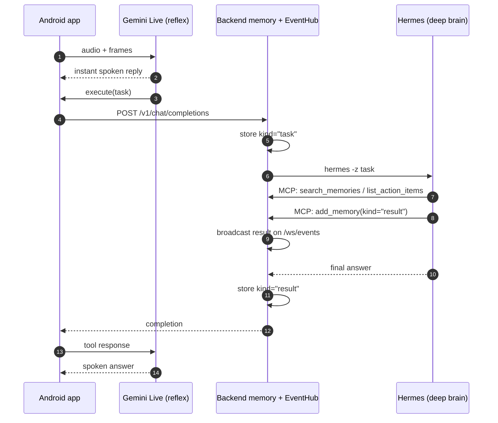

# Dual-brain architecture: Gemini Live + Hermes over one memory

Two brains, each doing what it's best at, over **one shared history**:

- **Gemini Live** is the *reflex*. Native audio and vision, runs from the Android app, answers out loud in
  about a second. Handles the live conversation ("what am I looking at?", "read this to me").
- **Hermes** is the *deep brain*. Runs on your server, uses tools, and does durable multi-step work
  (research, notes, lists) with Claude Sonnet 4.6.

They stay consistent because **both work against the same memory store**. The design follows VisionClaw
([arXiv 2604.03486](https://arxiv.org/html/2604.03486v2)), which paired Ray-Ban Meta, Gemini Live and an
agent gateway.

## What happens today

1. **Live conversation.** You speak; the app streams audio and frames to Gemini Live, which replies out loud.
2. **Deep work.** When Gemini calls `execute`, the backend records the task, runs it through Hermes, and
   Hermes reads the shared memory through MCP before acting.
3. **Write-back.** Hermes stores what it learns with `add_memory`. The backend also stores the final answer,
   so the next question, from either brain, can build on it.
4. **Reply.** The answer returns through the `execute` call and Gemini speaks it. `result` writes are also
   broadcast on `/ws/events` for any subscriber.

## Built in the backend, next for the app

The backend already supports a richer sync loop; the app doesn't use these endpoints yet
(see the [roadmap](ROADMAP.md)):

| Endpoint | What it enables |
|---|---|
| `POST /turn` | Mirror every Gemini turn into shared memory, so Hermes sees the whole conversation |
| `POST /ingest_frame` | Caption frames into searchable `observation` memories ("what did I see earlier?") |
| `WS /ws/ingest` | Stream audio for transcription and automatic action-item extraction |
| `WS /ws/events` | Speak long-running agent results the moment they land |

## Routing rule of thumb

| Utterance | Goes to |
|---|---|
| "What does this label say?" / "translate that" | **Gemini Live** (instant, in-context) |
| "Research X and save it to my notes" / "what are my action items?" | **Hermes** via `execute` (durable work, memory) |
| "Pay this QR" | **On the phone** (`scan_payment_qr`, `initiate_payment`), never the server |

The routing lives in the app's system prompt (`settings/SettingsManager.kt`): anything durable or personal
goes through `execute`, and personal queries are prefixed with *"Using the aiglass memory tools,"* so Hermes
reads real memory instead of its own empty to-do list.

## Scaling note

The `EventHub` is a single-process asyncio fan-out (great for one VPS). For multi-process (API + separate
MCP/Hermes hosts) or multi-VPS, swap `EventHub.publish` for a **Redis pub/sub** channel — the interface is
identical, nothing else changes. `AIGLASS_API_URL` already lets the MCP process reach the API's `/turn`.

## Configuration

- **Gemini** (app-side, real-time): use `gemini-2.5-flash-native-audio-preview` via the Gemini Live API.
- **Gemini** (backend vision, optional): point `VISION_BASE_URL` at Gemini's OpenAI-compatible endpoint +
  `VISION_MODEL=gemini-2.5-flash`, `VISION_PROVIDER=llm`.
- **Hermes**: `HERMES_BIN` for the `/v1/chat/completions` shim; `ORCH_PROVIDER=hermes`, `HERMES_URL`,
  `HERMES_API_KEY` for pushing extracted action items (see [HERMES_DEPLOY.md](HERMES_DEPLOY.md)).
