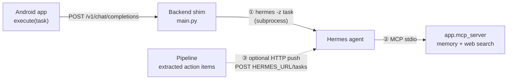

# Hermes agent: install and connect

[Hermes](https://github.com/nousresearch/hermes-agent) is the deep brain. It takes a task, reasons with
Claude Sonnet 4.6, and uses the aiglass MCP tools to read and write your memory.

## Two connections



| | Connection | Used for | Config |
|---|---|---|---|
| ① | **Shim → Hermes CLI** | Every `execute` call from the glasses. This is the main path | `HERMES_BIN`, `HERMES_TIMEOUT` |
| ② | **Hermes → MCP server** | The agent reading and writing memory, and web search | Hermes's MCP config |
| ③ | **Pipeline → Hermes HTTP** (optional) | Pushing action items extracted from transcripts | `ORCH_PROVIDER=hermes`, `HERMES_URL`, `HERMES_API_KEY` |

For ③, `POST {HERMES_URL}/tasks` with `{instruction, kind, source}` is the contract assumed by
`app/orchestrator/hermes.py`. Adjust it to your Hermes version's intake API. The backend degrades
gracefully if Hermes is unreachable, which `tests/test_hermes_handoff.py` checks.

## Install

On the same server as the backend:

```bash
curl -fsSL https://hermes-agent.nousresearch.com/install.sh | sh
hermes init
which hermes            # usually ~/.local/bin/hermes
```

1. **Model.** Choose Claude Sonnet 4.6 through the Anthropic API. Use a direct provider: an
   OpenAI-compatible proxy that strips tool definitions breaks tool-calling, and the agent silently
   stops using its tools.
2. **MCP server.** Register aiglass as a stdio MCP server in Hermes's config (`~/.hermes/config.yaml`):

   | Field | Value |
   |---|---|
   | command | `~/aiglass/backend/.venv/bin/python` |
   | args | `-m app.mcp_server` |
   | working directory | `~/aiglass/backend` |
   | env | `AIGLASS_DB`, `TAVILY_API_KEY`, `API_TOKEN`, `AIGLASS_API_URL` (same as `/etc/aiglass.env`) |

3. **Shim.** Set `HERMES_BIN` in `/etc/aiglass.env` to the absolute path from `which hermes`, because
   systemd's `PATH` is minimal. Then `sudo systemctl restart aiglass-backend`.

## Verify

```bash
cd ~/aiglass/backend && .venv/bin/python -m pytest tests/ -q        # contract tests, no live Hermes needed
hermes -z "Using the aiglass memory tools, list my action items."   # Hermes reaches the MCP tools
curl -s -H "Authorization: Bearer $API_TOKEN" -H "Content-Type: application/json" \
  -d '{"messages":[{"role":"user","content":"What can you do?"}]}' \
  https://<your-host>/v1/chat/completions                            # the full shim path
```

## Security

- Keep Hermes's tool execution sandboxed to bound what a bad task can do.
- Keep keys in `/etc/aiglass.env` or Hermes's own `.env`, never in the repo.
- Purchases and other irreversible actions stay human-approved.
