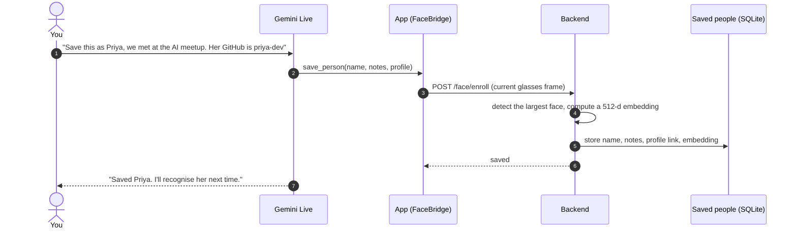
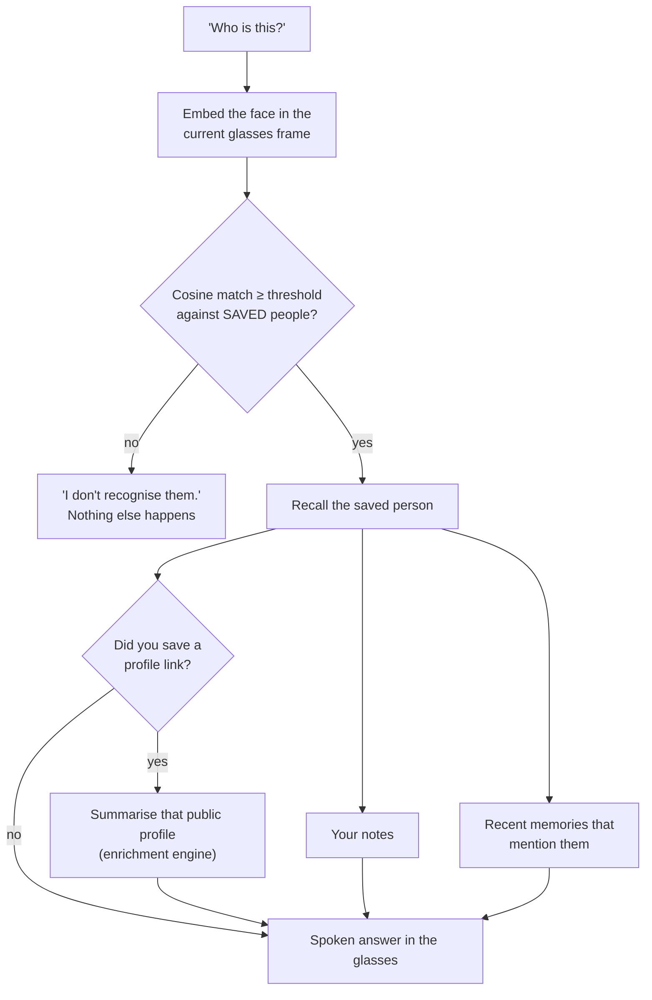
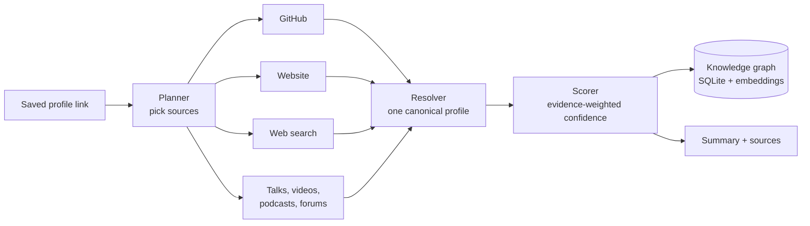

# People memory

Meet someone, and if they're happy to be remembered, say *"save this as Priya, we met at the Pune AI
meetup"*. Next time you see her and ask *"who is this?"*, aiGlass tells you who she is, what you noted about
her, what you last talked about, and a short summary of the public profile she shared with you.

It works only for people **you have saved**. An unknown face gets *"I don't recognise them"*, and there is
no way to ask it about a stranger.

## Saving someone

Only the face embedding is kept, not the photo. Save several photos of the same person to make matching
more robust; their notes and profile link are merged.

## Recognising and recalling

Example answer: *"This is Priya. Met at the Pune AI meetup. Last time: Priya said she is hiring Android
devs. Profile: Android engineer, maintains an open-source Compose library."*

The agent can recall the same information by name ("what do I know about Priya?") through the
`recall_person` MCP tool. It returns `known: false` for anyone not saved.

## Profile enrichment engine (`backend/app/osint/`)

When you saved a public profile link for someone, the engine turns it into a short, sourced summary. It only
ever runs on that link, never on a bare name or on someone who isn't saved.

| Part | Role |
|---|---|
| `workers/*.py` | One file per public source. Each returns a typed `WorkerResult`; `@worker` adds timeout, retries with backoff, caching and logging |
| `registry.py` | Discovers workers automatically and runs the chosen ones in parallel. One failing source never fails the whole thing |
| `planner.py` | Picks sources from the link (GitHub handle, website domain, …). An optional LLM planner is behind `OSINT_LLM_PLANNER=1` |
| `resolver.py` · `merger.py` · `scorer.py` | Merge the results into one profile, keep the sources, and score confidence by source quality and corroboration |
| `graph/` | Stores profiles and relationships in SQLite, with embeddings for semantic search |
| `cache.py` | Per-source, per-profile and per-summary TTL caches (cachetools, with a stdlib fallback) |
| `streaming.py` | Per-source progress events, for a live "looking up…" UI |

Email, calendar and local-files sources are stubs that report "not configured" rather than inventing data.

## Rules built into the code

| Rule | Where it is enforced |
|---|---|
| Only saved people are ever matched | `FaceStore.match` compares against saved embeddings only, with a minimum score (`FACE_THRESHOLD`, default 0.5) |
| No recall for anyone not saved | `PeopleMemory.recall` returns `known: false`, and `GET /people/{name}` answers 404 |
| Enrichment uses only the link you saved | `PeopleMemory.recall` passes the saved link, never the name, to the engine |
| No open "look up this person" route | There is no endpoint or MCP tool that takes an arbitrary name and searches for it (`tests/test_people_routes.py`) |
| The agent is told not to guess | The app's prompt and tool descriptions say: never guess a stranger's identity |
| You can forget anyone | `DELETE /face/{name}` removes their face data, notes and profile link |

## Responsible use

- **Ask first.** Save someone only after they agree, and tell them they can ask you to delete it.
- **Know your local law.** Face data is biometric data in many places, including under India's DPDP Act
  and the EU's GDPR.
- **Keep it on your server.** Embeddings and notes live in the backend's SQLite file, behind the bearer token.

## Configuration

| Variable | Default | Meaning |
|---|---|---|
| `FACE_EMBEDDER` | `mock` | `insightface` for real embeddings (`pip install insightface onnxruntime opencv-python-headless numpy`) |
| `FACE_MODEL` | `buffalo_s` | InsightFace model pack |
| `FACE_THRESHOLD` | `0.5` | Minimum cosine similarity for a match |
| `GITHUB_TOKEN` | — | Optional, higher GitHub API limits for enrichment |
| `TAVILY_API_KEY` | — | Web search source |
| `OSINT_WORKER_TIMEOUT` · `OSINT_WORKER_RETRIES` | `8` · `2` | Per-source time budget and retries |
| `OSINT_ENTITY_CACHE_TTL` | `86400` | How long a profile summary is cached, in seconds |
| `OSINT_LLM_PLANNER` · `OSINT_LLM_SUMMARY` | `0` · `0` | Optional LLM planning and summaries (use the `VISION_*` endpoint) |
