# Roadmap

## Status

```mermaid
flowchart LR
    subgraph Done["✅ Done"]
        D1["Backend core<br/>pipeline · memory · auth"]
        D2["Hermes + Claude agent<br/>via MCP"]
        D3["Glasses app on Ray-Ban Meta<br/>Gemini Live"]
        D4["UPI QR pay<br/>with spoken confirmation"]
        D5["AWS deploy<br/>Caddy HTTPS · systemd"]
        D6["Spider-Sense firmware"]
    end
    subgraph Next["🔜 Next"]
        N1["App subscribes to /ws/events<br/>and mirrors turns to /turn"]
        N2["Auto-capture: caption frames<br/>into memory"]
        N3["LLM action-item extractor"]
        N4["Spider-Sense alerts in the app"]
    end
    subgraph Later["🧭 Later"]
        L1["Port the brain to Meta's<br/>Muse Spark + SAM 3.1"]
        L2["Redis EventHub<br/>for multi-process"]
        L3["Postgres + vector search<br/>for memory"]
    end
    Done --> Next --> Later
```

## Done

| Milestone | Verified by |
|---|---|
| Backend core: capture → transcript → memory → action items → hand-off | `tests/test_pipeline.py` |
| OpenAI-compatible shim to the Hermes agent | `tests/test_shim.py`, live on the glasses |
| Hermes on Claude Sonnet 4.6 with aiglass MCP tools | Live: "list my action items" answered from memory |
| Glasses app: camera, voice, tool routing | Live on Ray-Ban Meta Gen 1 with Developer Mode |
| UPI QR pay | Scan, parse, confirm and intent launch verified in logcat. Personal QRs are declined by NPCI rules; merchant QRs are the target |
| Deploy: Lightsail, Caddy + Let's Encrypt, token auth | Deployed in ap-south-1 (Mumbai) |
| Spider-Sense firmware and bring-up guide | Compiles for ESP32 (Arduino core 3.3, Pololu VL53L1X 1.3) |

## Next

1. **Live result push.** The app subscribes to `/ws/events`, so long-running agent results are spoken as soon
   as they land, and it posts every turn to `/turn` so the agent sees the whole conversation.
2. **Auto-capture.** Caption the glasses feed into searchable `observation` memories through
   `/ingest_frame` ("where did I leave my keys?"), behind an explicit on/off control.
3. **Smarter action items.** Replace the rule-based `actions.py` with one LLM call that returns the same type.
4. **Spider-Sense in the app.** Subscribe to the band's BLE notifications and announce the direction of
   close calls.

## Later

- **Meta Model API.** Move perception and reasoning to Muse Spark (video, images and long context in one
  call) and use SAM 3.1 for object segmentation and tracking in the glasses feed.
- **Scale-out.** Swap the in-process `EventHub` for Redis pub/sub, and SQLite for Postgres with vector search.
- **Stateful web actions** (bookings, carts), always ending in a human approval step.

## Non-goals

- **Identifying strangers.** No face recognition, no lookups of people.
- **Autonomous payments.** aiGlass prepares; you authorise.
- **Moving the Spider-Sense safety loop off the ESP32.** The phone is telemetry only.
