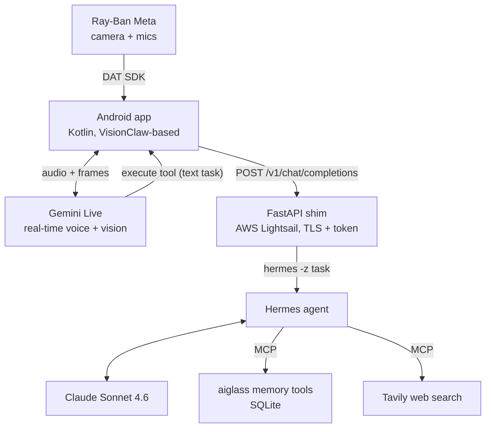

# aiGlass — System Overview

A self-hosted AI assistant for **Ray-Ban Meta Gen 1** glasses. Voice + camera in, agentic actions out —
all self-hosted except the two cloud model APIs (Gemini for perception, Claude for the agent).

**One-line summary:** Ray-Ban Meta → VisionClaw Android app → **Gemini Live** (voice+vision) → `execute`
tool → custom **FastAPI shim** on **AWS Lightsail** → **Nous Hermes Agent** (**Claude Sonnet 4.6** via
Anthropic API) with **MCP** memory tools + **Tavily** web search.



## 1. Deployment

| Component | What it actually is |
|---|---|
| **Host** | AWS **Lightsail** `small_3_1` (2 GB / 2 vCPU), Ubuntu 22.04, ap-south-1 (Mumbai), static IP |
| **TLS / entry** | **Caddy** + Let's Encrypt → `https://<ip-with-dashes>.nip.io` (nip.io wildcard DNS, no domain needed) |
| **Backend** | Custom **Python FastAPI** app (`backend/app/`), `systemd` service `aiglass-backend` |
| **MCP server** | `python -m app.mcp_server` (stdio), spawned by Hermes |
| **Agent** | **Nous Research Hermes Agent** (Python framework), `~/.local/bin/hermes`, `systemd --user` service `hermes-gateway` |
| **Agent LLM** | **Claude Sonnet 4.6 via native Anthropic Cloud API** — no self-hosted model, no GPU, no vLLM/TGI/Bedrock/SageMaker |
| **Perception LLM** | **Gemini 2.5 Flash native-audio (Live API)** — app-side, handles real-time voice + vision |
| **Web search** | **Tavily** (key in Hermes `.env`) |
| **Auth** | Bearer token on every endpoint except `/health` (`API_TOKEN` in `/etc/aiglass.env`) |

> **Not** OpenClaw and **not** LangChain. The app UI shows an "OpenClaw" pill only because it's the
> **VisionClaw** sample repurposed to point at our FastAPI shim.

## 2. Data flow

1. **Perception (Gemini):** The Ray-Ban's camera frames (~1 fps JPEG, q50) + audio stream over BLE to the
   phone, which forwards them to the **Gemini Live** WebSocket. Gemini does the live voice conversation and
   sees through the camera. **Claude never receives images** — there is no Anthropic image wrapper.
2. **Action (Hermes/Claude):** When the user asks for something actionable, Gemini calls its single
   `execute` tool → the app POSTs the **text** task to the backend's `/v1/chat/completions`.
3. **Orchestration:** The FastAPI shim logs the task to memory, runs it via `hermes -z "<task>"`, and
   returns the result in OpenAI chat-completions shape. Hermes uses **Claude Sonnet 4.6** + MCP tools
   (memory, web search) to actually do the work, then the answer is spoken back through the app.

## 3. Key code

**The shim + Hermes runner** — `backend/app/main.py`:
```python
async def _run_hermes(task: str) -> str:
    proc = await asyncio.create_subprocess_exec(
        settings.hermes_bin, "-z", task,
        stdout=asyncio.subprocess.PIPE, stderr=asyncio.subprocess.STDOUT)
    out, _ = await asyncio.wait_for(proc.communicate(), timeout=settings.hermes_timeout)
    return _ANSI.sub("", out.decode("utf-8", "replace")).strip() or "Done."

@app.post("/v1/chat/completions", dependencies=[Depends(require_auth)])
async def chat_completions(body: ChatCompletionRequest) -> dict:
    task = extract_task([m.model_dump() for m in body.messages])
    memory.add_memory("task", task, source="glass")
    result = await _run_hermes(task)              # Hermes → Claude happens here
    memory.add_memory("result", result, source="hermes")
    return shape_completion(result)
```

**The MCP tools Hermes/Claude gets** — `backend/app/mcp_server.py`:
```python
@mcp.tool() def search_memories(query, limit=10)   # search captured memories
@mcp.tool() def recent_transcripts(limit=20)       # recent conversation transcripts
@mcp.tool() def list_action_items(limit=50)        # open action items
@mcp.tool() def add_memory(kind, text)             # write a fact/summary/result back
```

**Frame config (app side)** — `gemini/GeminiConfig.kt`:
```kotlin
const val MODEL = "models/gemini-2.5-flash-native-audio-preview-12-2025"
const val VIDEO_FRAME_INTERVAL_MS = 1000L   // ~1 fps
const val VIDEO_JPEG_QUALITY = 50
```

## 4. Prompts

**Gemini system prompt** (`app/…/settings/SettingsManager.kt`, `DEFAULT_SYSTEM_PROMPT`) — the important bits:
```
You are an AI assistant for someone wearing Meta Ray-Ban smart glasses...
You have exactly ONE tool: execute. This connects you to a powerful personal assistant...
CRITICAL ROUTING: For anything about the user's OWN tasks, action items, reminders, to-dos,
lists, notes, or captured memory, phrase the execute task to START WITH
"Using the aiglass memory tools, " — e.g. "Using the aiglass memory tools, list my action items."
```

**Hermes/Claude prompt:** Hermes manages its own system prompt internally; what we inject is the **MCP
tool set** above. That's what makes Claude cooperate with the user's memory.

## 5. Android app

Reused from **[Intent-Lab/VisionClaw](https://github.com/Intent-Lab/VisionClaw)** (`samples/CameraAccessAndroid`),
not rewritten. Runtime config (gitignored `Secrets.kt`): Gemini key, `openClawHost=https://<your-server>`,
port 443, `openClawGatewayToken` = backend API token. Uses the **Meta Wearables DAT SDK** (GitHub Packages,
needs a PAT). Requires Developer Mode enabled in the Meta AI app to pair the glasses.

## 6. Status & next steps

- ✅ Voice, vision, memory, agent tool-calling and web search, working end-to-end.
- ✅ Glasses camera stream (needs Developer Mode on the glasses).
- ✅ UPI QR pay from the glasses, with spoken confirmation and a ₹1,400 voice cap.
- ✅ Spider-Sense firmware and build guide.
- ✅ People memory: save someone, then "who is this?" recalls them (saved people only). See [PEOPLE_MEMORY.md](PEOPLE_MEMORY.md).
- ⬜ App subscribes to `/ws/events` and mirrors turns to `/turn`, so the backend sees every turn.
- ⬜ Auto-capture: continuously caption frames into memory (`/ingest_frame` is ready).
- ⬜ Stateful web actions (e.g. add-to-cart). They need a logged-in browser session and are fragile due to
  bot detection; purchases must stay a manual, human-approved step.

The full plan is in [ROADMAP.md](ROADMAP.md).

See also: [ARCHITECTURE](ARCHITECTURE.md) · [DUAL_BRAIN](DUAL_BRAIN.md) · [HERMES_DEPLOY](HERMES_DEPLOY.md) · [ROADMAP](ROADMAP.md)
