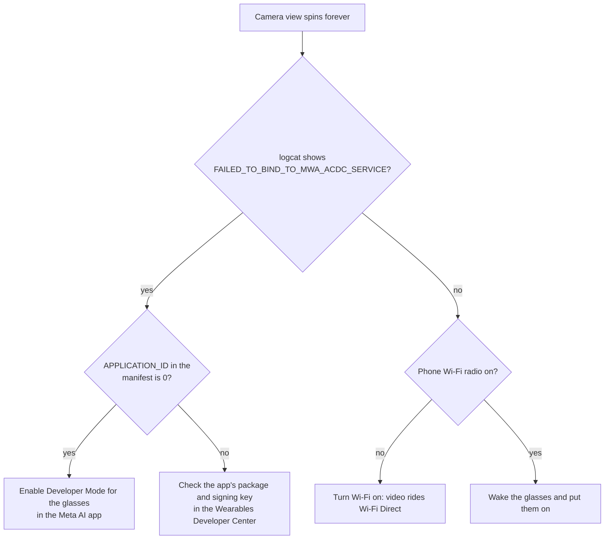

# Troubleshooting

Real problems hit while building aiGlass, written as symptom → cause → fix.

## Glasses camera stuck on "loading"

- **Symptom.** The phone camera path works; the glasses path spins forever. The BLE control link is fine
  (`cameraState=CAPTURE_READY`), but the video transport lease fails.
- **Cause.** Not Wi-Fi. The manifest's `com.meta.wearable.mwdat.APPLICATION_ID` is the placeholder `0`, which
  the Meta AI app only honours when the glasses are in **Developer Mode**. Without it, the lease bind is
  refused silently.
- **Fix.** Register as a Wearables developer, accept the toolkit terms, and turn on Developer Mode in the
  Meta AI app (device settings). For distribution, register the app to get a real `APPLICATION_ID`.
- **Confirm.** `FAILED_TO_BIND` stops, a Wi-Fi Direct lease goes active, and video frames flow.

## No voice input from the glasses while the camera streams (Gen 1)

- **Symptom.** You hear the AI in the glasses, but recording comes from the phone mic.
- **Cause.** On Ray-Ban Meta Gen 1, one-way A2DP output coexists with the camera stream, but the two-way
  SCO voice link the glasses mic needs is dropped while the camera runs.
- **Fix.** Nothing to fix. The app routes output to the glasses and records from the phone mic, which works from a
  pocket. Use voice-only mode for the glasses mic, or pair a Bluetooth earbud as the mic.
- **Gotcha.** Meta's own `a2dpConnected=false` log line describes the Meta assistant's view, not Android's
  A2DP state. Check the `bluetooth-a2dp` logs instead.

## UPI payment "declined" for personal QR codes

- **Symptom.** Scanning, parsing and launching all work, then GPay, PhonePe, Paytm and WhatsApp all say
  "transaction declined" in exactly the same way.
- **Cause.** All four use NPCI's shared UPI library. `upi://pay` intents with a pre-filled amount are a
  merchant (P2M) flow; banks refuse them for person-to-person QRs started by a third-party app. Paying the
  same address inside GPay works, so it isn't the account.
- **Fix.** Target merchant QRs (they carry `mc` / `mid` codes). Fallback: launch the intent without `am` and
  let the user type the amount.
- **Security note.** The `pn=` payee name in a QR is whatever the printer chose. QR-sticker swaps are a real
  scam, so only trust the name the bank resolves in the UPI app.

## The agent ignores your real memory

- **Symptom.** "What are my action items?" returns an empty list.
- **Cause.** Hermes has a built-in, empty to-do tool, and it won the routing over the aiglass MCP tools.
- **Fix.** The app's system prompt makes Gemini start personal tasks with *"Using the aiglass memory tools,"*,
  which steers Hermes to the right tools.

## The agent stops using tools at all

- **Symptom.** Hermes answers in plain text and never calls a tool.
- **Cause.** An OpenAI-compatible proxy between Hermes and the model stripped the tool definitions.
- **Fix.** Use the model provider directly (Anthropic API for Claude Sonnet 4.6).

## `ModuleNotFoundError: No module named 'mcp.server.fastmcp'`

- **Cause.** MCP Python SDK 2.x renamed `FastMCP` to `MCPServer`.
- **Fix.** `pip install "mcp>=1.0,<2"`. The repo's `requirements.txt` already pins this.

## Gradle: `401 Unauthorized` downloading `com.meta.wearable:mwdat-*`

- **Cause.** Meta's DAT SDK is served from GitHub Packages, and the token is missing, expired, or lacks
  `read:packages`.
- **Fix.** Create a token with `read:packages` and put it in `android/local.properties` as
  `github_token=...`, or export `GITHUB_TOKEN`. With the GitHub CLI: `gh auth refresh -s read:packages`,
  then `export GITHUB_TOKEN=$(gh auth token)`.

## Shim answers "Hermes is not reachable (check HERMES_BIN)"

- **Cause.** systemd's minimal `PATH` can't find `hermes`.
- **Fix.** Set `HERMES_BIN` in `/etc/aiglass.env` to the absolute path from `which hermes`, then
  `sudo systemctl restart aiglass-backend`.
