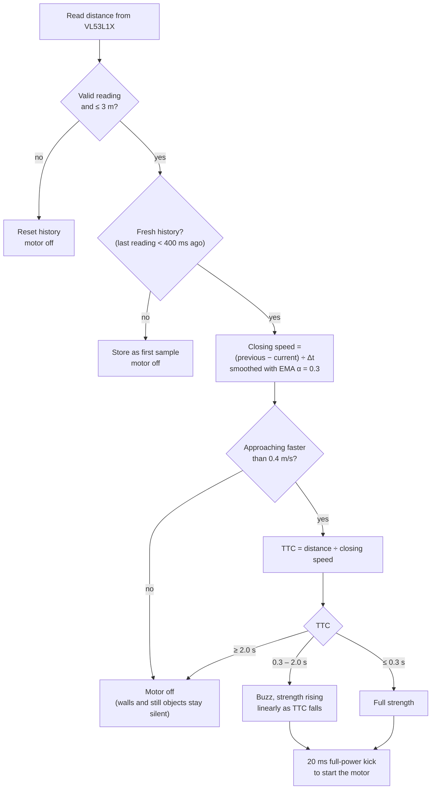
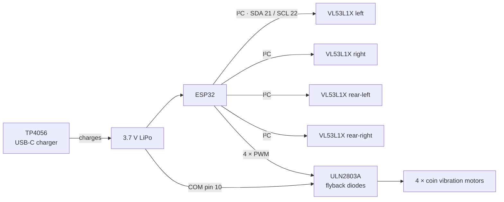

# Spider-Sense Band

A haptic proximity warning band that covers the blind spots the Ray-Ban Meta
camera cannot see — your **sides and behind you**. Four time-of-flight sensors
detect *approaching* objects and buzz a vibration motor on the matching side.

It complements the glasses rather than duplicating them:

| | covers | feedback |
|---|---|---|
| Ray-Ban Meta | forward | AI voice |
| This band | sides + rear | instant haptic |

Inspired by MateoTechLab's spider-sense glasses. The essential idea is that it
filters for **approach speed, not distance** — otherwise every wall you stand
near buzzes forever. This firmware goes one step further and uses
**time-to-collision** (`distance ÷ closing speed`), which correctly ranks a slow
hand at 30 cm as more urgent than a fast car at 4 m.

## How it works

Each sensor is read about every 33 ms. Per direction, the firmware runs this loop:



The haptic decision never leaves the ESP32. Over BLE the band only reports the most urgent direction to
the phone, for example `{"dir":"rear-L","d":1.20,"v":0.85,"ttc":1.41}`.



## Parts

| Part | Qty | ~₹ each |
|---|---|---|
| ESP32 DevKit V1 (or ESP32-C3 SuperMini) | 1 | 250–450 |
| VL53L1X ToF sensor (4 m) | 4 | 500–700 |
| *budget alt:* VL53L0X (2 m) | 4 | 200–350 |
| ULN2803A darlington array | 1 | 25–40 |
| 10 mm coin vibration motor, 3 V | 4 | 40–80 |
| TP4056 USB-C charging module | 1 | 30–50 |
| 3.7 V LiPo, 1000 mAh | 1 | 150–300 |
| Perfboard, wire, JST connectors | — | 150–250 |

**Total ≈ ₹1,700 (VL53L0X) to ₹3,200 (VL53L1X)**

Sources: Robu.in, Robocraze, Quartz Components, ThinkRobotics — or Lamington
Road (Mumbai) / SP Road (Bengaluru) / Lajpat Rai Market (Delhi).

## Wiring

**I²C bus — all four sensors share SDA/SCL:**

| VL53L1X | ESP32 |
|---|---|
| VIN | 3V3 |
| GND | GND |
| SDA | GPIO 21 |
| SCL | GPIO 22 |
| XSHUT | one GPIO each — see below |

**Per-direction pins:**

| Direction | XSHUT | Motor (ULN2803A input) |
|---|---|---|
| left | GPIO 25 | GPIO 32 |
| right | GPIO 26 | GPIO 33 |
| rear-left | GPIO 27 | GPIO 18 |
| rear-right | GPIO 14 | GPIO 19 |

**Motors via ULN2803A** — never drive a motor straight off a GPIO (they pull
~80–100 mA; a pin gives 20–40 mA, and the inductive kickback will kill it). The
ULN2803A has flyback diodes built in, which is exactly what you need:

```
ESP32 GPIO ──► ULN2803A IN(n)     OUT(n) ──► motor ── ──► motor + ──► +3.7V (battery)
                       GND ──► GND        COM ──► +3.7V
```

Tie `COM` (pin 10) to the battery positive — that is the flyback return path.
Leaving it unconnected is the single most common way to fry this circuit.

### ESP32-C3 SuperMini

Fewer pins. Suggested remap (edit `CFG` and `I2C_SDA`/`I2C_SCL` in the sketch):
SDA 8, SCL 9, XSHUT 0/1/2/3, motors 4/5/6/7.

## Build & flash

1. Arduino IDE → Boards Manager → install **esp32** by Espressif.
2. Library Manager → install **VL53L1X** by *Pololu* (not Adafruit — this code
   uses Pololu's `setAddress()` API).
3. Select your board, then Upload.

Works on both ESP32 core 2.x and 3.x — the LEDC PWM API changed between them and
the sketch handles each.

## Bring-up order

Do these in order; each step is verifiable on its own.

**1 — Motors.** Set `#define MOTOR_SELFTEST 1`, flash. Each motor should buzz in
turn, and the serial monitor names it. Confirms wiring, ULN2803A and power
before sensors are involved. Set back to `0` when done.

**2 — One sensor.** Wire one VL53L1X. Serial monitor at **115200** should print
`[ok] sensor 0 (left) at 0x30`. Move your hand toward it — you should see
distance/velocity/TTC lines and feel the motor.

**3 — Tune.** Stand near a wall. It must stay **silent** — if it buzzes, raise
`MIN_CLOSING_MPS`. If it misses fast objects, lower `MIN_CLOSING_MPS` or raise
`TTC_ALERT_S`.

**4 — All four sensors.** Watch for four `[ok]` lines at 0x30–0x33. A `[FAIL]`
almost always means an XSHUT pin is wrong — that is the address-assignment
dance, and it is the one thing that reliably goes wrong.

**5 — Phone.** Set `ENABLE_BLE 1`; the board advertises as `SpiderSense` and
notifies JSON like `{"dir":"rear-L","d":1.20,"v":0.85,"ttc":1.41}`.

## Tuning reference

| Constant | Does what | Raise it if… |
|---|---|---|
| `MIN_CLOSING_MPS` | approach speed floor | it buzzes at stationary things |
| `TTC_ALERT_S` | when warning starts | you want earlier warning |
| `MAX_RANGE_M` | ignore beyond this | — |
| `VEL_SMOOTHING` | EMA α (lower = smoother) | readings are jumpy |
| `MOTOR_MIN_DUTY` | weakest buzz | you cannot feel a light alert |
| `MOTOR_MAX_DUTY` | strongest buzz | keep ≤200 — motors are 3 V, LiPo is 4.2 V |

## Known limitations

- **ToF beams are narrow (~27°).** Four sensors give four cones, not 360°
  coverage. True coverage needs 8–12. Start with the blind spots that matter.
- **Bright sunlight cuts range badly** (IR washout — 4 m can drop under 1 m).
  Fine for night use, weak at noon.
- **The haptic loop is deliberately local to the ESP32.** BLE is telemetry only;
  never move the safety path onto the phone, where latency is 100–300 ms.
